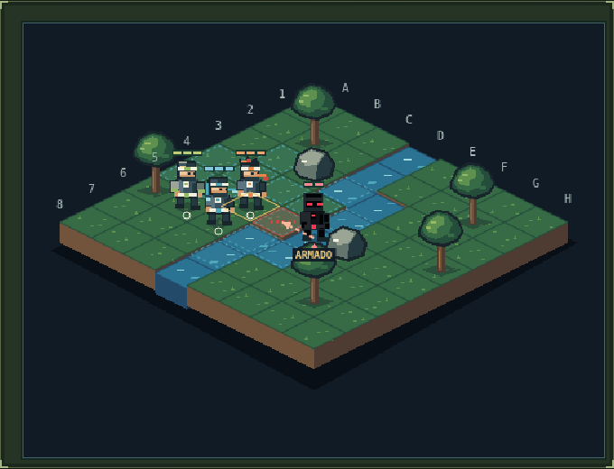
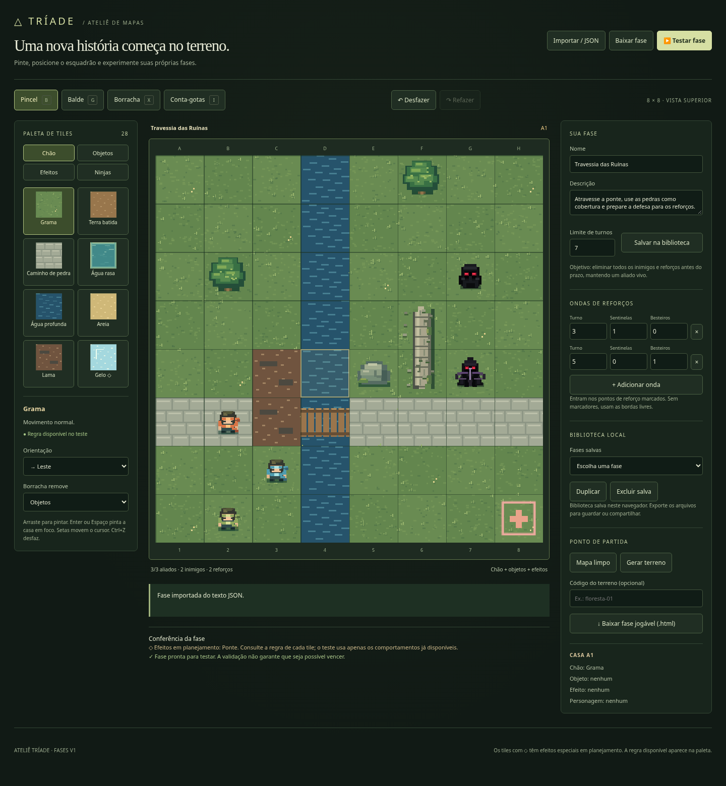

# Into the Shinobi

## Game Design Document — Prototipação

**Versão 0.1 · 21 de outubro de 2026**

Documento de trabalho para consolidar o protótipo existente, a direção solicitada para o jogo e as decisões que ainda precisam de experimentação.

**Identidade em desenvolvimento.** O protótipo executável se chama *Tríade — Clareira do Rio*. A especificação visual usa *Into the Shinobi* e o board mencionado pelo criador se chama *Into The Sinobi - Roadmap*. A grafia e o título definitivos ainda precisam ser confirmados.

**Leitura de status:** IMPLEMENTADO descreve o código atual; ENSAIO descreve uma experiência separada; DIREÇÃO SOLICITADA registra intenção do criador; PROPOSTA descreve uma alternativa a avaliar; EM ABERTO identifica decisão pendente. Recurso implementado não significa equilíbrio ou diversão já validados.

## Visão rápida

- Jogo tático 2D por turnos para PC, com equipes de três ninjas entre cinco elementos.
- Posicionamento, empurrões, colisões, leitura de ataques e uso do cenário são a base implementada.
- Combinações de chakra, missões por rank e história fazem parte da direção de desenvolvimento; ainda não integram a campanha jogável.
- A proposta mais recente é organizar cada missão em aproximadamente quatro ou cinco levels, com um terreno predominante e variações de desafios.
- O objetivo imediato é delimitar e testar a experiência. Quantidade total de mapas, tamanho da campanha, câmera definitiva e prazo de produção permanecem em aberto.
- As artes finais serão a última etapa, depois de validar regras, conteúdo e leitura tática.

# 1. Visão do projeto

**Conceito de trabalho:** comandar um esquadrão ninja elemental em confrontos curtos, usando posição, terreno e informação antecipada para resolver objetivos táticos. No desenvolvimento pretendido, as escolhas de equipe e a cooperação entre elementos também alteram a maneira de cumprir as operações.

**Gênero:** tático por turnos, com resolução de problemas espaciais. O peso relativo de combate, quebra-cabeça, narrativa e progressão ainda será decidido.

**Plataforma inicial:** PC. A implementação atual funciona no navegador e em HTML offline. Distribuição por executável e canal comercial não estão fechados.

**Público pretendido — hipótese:** pessoas que gostam de planejamento, partidas sem exigência de reflexo e consequências visíveis. Faixa etária, dificuldade de entrada e duração de sessão ainda precisam de definição.

**Objetivo geral do jogador — direção:** cumprir operações de um esquadrão ninja, avançando por missões de diferentes tipos e riscos. O destino final da campanha e o critério de concluir o jogo ainda não foram definidos.

**Objetivo imediato da prototipação:** verificar se as regras comunicam consequências, oferecem alternativas interessantes e sustentam mais de um objetivo de missão e diferentes formações.

## 1.1 Pilares propostos

1. **Posicionamento com consequência:** deslocar um inimigo ou uma pedra pode mudar mais que causar dano direto.
2. **Informação para planejar:** a interface revela intenções e permite consultar resultados antes de confirmar.
3. **Cooperação elemental:** trios diferentes oferecem soluções distintas; combinações precisam justificar os recursos que consomem.
4. **Terreno com função:** rio, obstáculos e futuros estados alteram rotas, proteção e prioridades.
5. **Missões com propósito:** o objetivo tático se conecta à história e às consequências da operação.

Os pilares orientam os experimentos; a formulação final depende dos testes com jogadores.

# 2. Estado real do projeto

| Área | Estado em 21/10/2026 |
| --- | --- |
| Combate básico e seleção de três entre cinco ninjas | IMPLEMENTADO. Equilíbrio e papéis continuam em avaliação. |
| Empurrões, colisões, estruturas móveis, prévias e desfazer caminhada | IMPLEMENTADO. |
| Sentinela e Besteiro; preparação de ataques e ondas | IMPLEMENTADO. |
| Mapa procedural 8×8 e repetição por código | IMPLEMENTADO. Não há garantia de equilíbrio para toda semente. |
| Editor e 28 tiles | IMPLEMENTADO; parte dos tiles só tem comportamento básico ou marcador visual. |
| HTML offline e projeto GDevelop gerado | IMPLEMENTADO. Editor oficial e executável GDevelop ainda não validados. |
| Mapa e unidades em isometria | ENSAIO SEPARADO: mapa fixo, três ninjas iniciais e um inimigo. |
| Missões por rank, tipos e operações com 4–5 levels | DIREÇÃO SOLICITADA; fluxo de campanha não implementado. |
| Combinações de chakra | DIREÇÃO SOLICITADA; catálogo de dez propostas, sem ativação implementada. |
| História, briefings e progressão narrativa | DIREÇÃO SOLICITADA; argumento provisório em documento. |
| Integridade regional, recuperação entre levels e objetivos de proteção/resgate/infiltração | PROPOSTAS ou decisões EM ABERTO; não são regras atuais. |
| Quantidade final de missões, mapas e biomas | EM ABERTO. |
| Arte final e áudio definitivo | PRODUÇÃO FUTURA, após validação do recorte. |

# 3. Estrutura da experiência

## 3.1 Terminologia

- **Turno:** ciclo de ações do jogador e resolução/preparação inimiga.
- **Level ou cenário:** um confronto ou situação jogável em um mapa.
- **Mapa/layout:** geometria, terrenos, objetos e posições iniciais de um cenário. Um layout pode receber variações, sem ser contado automaticamente como um novo mapa único.
- **Missão ou operação:** tarefa narrativa com aproximadamente quatro ou cinco levels. Essa é a direção mais recente do criador.
- **Rank:** classificação de risco e complexidade da operação; não significa nível do personagem.
- **Campanha:** sequência de operações e consequências; ainda não implementada.

No código e na interface atuais, “missão” também nomeia a batalha isolada da Clareira do Rio. Isso não significa que a operação de vários levels já exista.

## 3.2 Ciclo atual implementado

Escolher três ninjas → observar mapa e intenções → selecionar unidade → mover ou agir em posição → consultar a prévia → executar Soco, Especial ou Esperar → encerrar turno → resolver ataques e preparar a próxima rodada → vencer, perder, repetir ou gerar outro mapa.

## 3.3 Ciclo de campanha pretendido

Escolher operação e consultar rank, terreno e objetivo → montar o trio → ler briefing curto → jogar os quatro ou cinco levels → lidar com consequências e retirada → receber resultado e acessar novas operações.

A troca de trio entre levels, a recuperação de PV, os desbloqueios, os recursos e os pontos de salvamento ainda serão definidos. A intenção é fazer o tipo da missão e seu terreno alterarem as decisões do jogador.

# 4. Regras de combate implementadas

## 4.1 Tabuleiro, movimento e ações

O mapa lógico possui 8×8 células. Movimento, distância e empurrões são ortogonais; não há diagonais de caminhada. Cada ninja começa com 3 PV e orçamento de 3 pontos de movimento por turno. Em terreno comum isso permite até três casas; lama aumenta o custo de entrada para 2.

Cada aliado pode fazer um deslocamento voluntário e uma ação. A ação pode ser Soco, Especial ou Esperar. Agir antes de caminhar encerra a vez da unidade, incluindo a possibilidade de movimento posterior. Selecionar outra unidade ou consultar a prévia não gasta uma ação.

Unidades e estruturas sólidas bloqueiam caminhada. Água rasa permite passagem com custo normal. Água profunda e abismo bloqueiam; pontes permitem atravessar água profunda. Essas regras não representam nado, salto ou queda automática.

## 4.2 Desfazer caminhada

Apenas o deslocamento voluntário pode ser desfeito, antes de usar uma ação, esperar ou encerrar o turno. A origem e a rota original precisam continuar livres. Um empurrão externo invalida esse retorno.

Desfazer devolve posição e disponibilidade de caminhada. Não desfaz dano, mudanças no terreno ou ações posteriores de outros aliados. Tentar um ataque inválido ou consultar uma prévia preserva a possibilidade de voltar.

## 4.3 Soco

Alcance de uma casa adjacente, 1 PV de dano e tentativa de empurrar uma casa na direção do golpe. Pode atingir inimigos e estruturas atacáveis. Não ataca diretamente aliados nem árvores. Muralhas e estruturas fixas atacáveis recebem dano sem deslocamento.

Se o golpe zera os PV de um personagem, a tentativa de empurrão ainda é resolvida antes de ele desaparecer. Em destino livre, ele é arremessado; diante de um personagem ou estrutura, o obstáculo ainda recebe o impacto. A derrota é contabilizada uma vez.

Pedras, caixas e barreiras destruídas pelo dano inicial se desfazem; não conservam o empurrão póstumo dos personagens.

## 4.4 Colisões

Quando um personagem ou estrutura móvel é empurrado contra outro personagem ou estrutura sólida, cada envolvido recebe 1 PV. Não há empurrão em cadeia. As partes permanecem nas posições da colisão mesmo que o obstáculo seja destruído.

Exemplo: um Soco contra um inimigo com outro personagem atrás provoca 1 PV do golpe e mais 1 PV da colisão no alvo; o personagem atrás perde apenas 1 PV. Ele pode ser aliado ou inimigo.

Árvores e muralhas têm 2 PV e recebem dano de colisão. Árvores com 1 PV mostram copa danificada e indicação de vida. A borda impede o empurrão sem dano adicional. Abismo não causa queda e água rasa não afoga: esses comportamentos não existem no protótipo atual.

As estruturas móveis conservam identidade, PV e o chão subjacente quando deslocadas. Remover uma pedra que estava sobre água restaura aquela água.

# 5. Personagens jogáveis

**IMPLEMENTADO:** cinco personagens; equipe de três elementos distintos; dez formações possíveis. Todos têm 3 PV, caminhada padrão de três pontos e Soco. Os nomes são os usados no protótipo.

| Ninja | Elemento | Especial | Regra atual |
| --- | --- | --- | --- |
| Ígni | Fogo | Projétil de Fogo | 1 PV no primeiro inimigo em linha ortogonal de até quatro casas. Unidades e obstáculos bloqueiam. Um disparo válido sem alvo também consome a ação. |
| Nami | Água | Onda Circular | Ativa no próprio tile. Empurra personagens e estruturas móveis das quatro vizinhas para fora. Sem dano direto; colisões seguem as regras compartilhadas. |
| Taro | Terra | Barreira de Terra | Cria barreira móvel de 2 PV em grama adjacente vazia. Criar outra substitui a anterior. Seu movimento atual é igual ao dos demais. |
| Rai | Raio | Dash Relâmpago | Avança em linha reta até a última casa livre antes do primeiro inimigo ou estrutura; causa 1 PV e tenta empurrar. Rai perde 1 PV. Aliados e terreno intransponível bloqueiam. Uma linha sem alvo não gasta a ação. |
| Sora | Vento | Rajada de Vento | Pode mirar qualquer casa. O centro fica intacto; empurra personagens e estruturas móveis nas quatro vizinhas. Sobrevoa personagens e pode atingir o próprio Sora quando ele está adjacente ao centro. Sem dano direto. |

Rai completa o impacto mesmo quando o custo de 1 PV o derrota. Se não restar aliado, a missão termina em derrota. O dash pode ser usado após a caminhada e encerra a ação.

Árvores e muralhas ficam paradas diante de Onda/Rajada; podem receber colisões. O impacto direto do dash também danifica estruturas fixas.

**Questões de equilíbrio:** diferenciar Água e Vento, pois a Rajada reproduz a área da Onda e atua à distância; demonstrar utilidade da barreira de Terra; verificar quando o custo de vida de Rai cria uma boa escolha. A implementação não resolve essas perguntas de design por si só.

# 6. Inimigos, intenções e ondas

## 6.1 Arquétipos existentes

| Inimigo | PV / movimento | Ataque | Comportamento e visual |
| --- | --- | --- | --- |
| Sentinela | 2 PV; até duas casas | 1 PV na casa adjacente anunciada. | Aproxima-se quando necessário. Corpo preto, máscara e olhos vermelhos. |
| Besteiro | 1 PV; até duas casas | Disparo ortogonal de até quatro casas; 1 PV no primeiro personagem ou barreira. | Busca linha de tiro ou mantém posição. Capuz pontudo, besta e detalhes violetas. Estruturas e vapor bloqueiam o tiro conforme as regras atuais. |

## 6.2 Ciclo inimigo

Ao encerrar o turno, inimigos sobreviventes executam os ataques preparados. Depois da resolução, entram reforços previstos e os inimigos avançam quando necessário para preparar o próximo ataque. Os controles aguardam o fim das animações relevantes.

Todos preparam uma direção a cada rodada, incluindo Besteiros sem aliado alinhado. Setas, casas ameaçadas e o aviso ARMADO tornam isso visível.

Empurrar um inimigo traslada o ataque junto com ele, preservando direção e distância preparada. Ele não volta a mirar ao final do turno. Bordas, personagens e obstáculos ainda limitam ou interceptam o ataque; um inimigo derrotado não ataca.

Mapas procedurais preparam o estado inicial com avanço inimigo. Fases do editor armam os ataques sem deslocar as posições colocadas pelo autor.

## 6.3 Batalha padrão atual

A Clareira do Rio começa com dois Sentinelas e um Besteiro. Os turnos 2, 3, 4 e 5 recebem 1, 2, 1 e 2 reforços, totalizando nove inimigos. Entradas bloqueadas podem adiar a chegada, mas os reforços continuam contando como pendentes.

Vitória: eliminar todas as ondas até o fim do turno 5, mantendo um aliado de pé. Limpar o campo com reforços pendentes não encerra a missão. O prazo termina sem criar turno 6. A perda de todo o esquadrão também derrota.

Cinco turnos e nove inimigos descrevem essa batalha, não uma regra já aprovada para todas as futuras operações. O editor admite prazos de 1–20 turnos e ondas configuráveis.

# 7. Terrenos e estruturas

O editor possui 28 entradas de catálogo. A coluna de regra atual abaixo é baseada nos dados do projeto; os efeitos pendentes não devem ser prometidos como jogáveis.

| Tile | Regra atual | Pendência |
| --- | --- | --- |
| Grama | Movimento normal. | Sem efeito adicional previsto nesta entrada. |
| Terra batida | Movimento normal. | Sem efeito adicional previsto nesta entrada. |
| Caminho de pedra | Movimento normal. | Sem efeito adicional previsto nesta entrada. |
| Água rasa | Pode ser atravessada. | Sem efeito adicional previsto nesta entrada. |
| Água profunda | Bloqueia caminhada; uma ponte permite atravessar. | Sem efeito adicional previsto nesta entrada. |
| Areia | Movimento normal. | Sem efeito adicional previsto nesta entrada. |
| Lama | Entrar custa 2 pontos de movimento; empurrões não gastam movimento. | Sem efeito adicional previsto nesta entrada. |
| Gelo | Pode ser atravessado com custo normal. | Deslizamento ainda em planejamento. |
| Árvore | Fixa, 2 PV; recebe dano de colisão. | Sem efeito adicional previsto nesta entrada. |
| Pedra | Móvel, 2 PV; preserva o chão ao ser empurrada. | Sem efeito adicional previsto nesta entrada. |
| Muralha em ruínas | Fixa, 2 PV; bloqueia passagem e tiros. | Sem efeito adicional previsto nesta entrada. |
| Arbusto | Permite passagem. | Ocultação e cobertura ainda em planejamento. |
| Tronco caído | Pinta 2 casas; segmentos fixos de 2 PV. | Movimento do tronco inteiro ainda em planejamento. |
| Caixa de madeira | Móvel, 1 PV; bloqueia passagem e tiros. | Sem efeito adicional previsto nesta entrada. |
| Pilar | Fixo, 2 PV; bloqueia passagem e tiros. | Queda direcional ainda em planejamento. |
| Ponte | Permite atravessar água profunda. | Destruição da ponte ainda em planejamento. |
| Espinhos | Marcador visível; permite passagem. | Dano ao entrar ainda em planejamento. |
| Abismo | Bloqueia caminhada. | Queda por empurrão ainda em planejamento. |
| Correnteza | Marca água e direção do fluxo. | Deslocamento automático ainda em planejamento. |
| Brasa | Marcador visível; permite passagem. | Dano no fim do turno ainda em planejamento. |
| Solo rachado | Pode ser atravessado. | Desmoronamento ainda em planejamento. |
| Placa de pressão | Marcador de mecanismo; permite passagem. | Ligação com portões ainda em planejamento. |
| Santuário | Marcador de objetivo; permite passagem. | Objetivos de proteger ou ocupar ainda em planejamento. |
| Ponto de reforço | Reforços usam estas entradas; se não houver marcadores, usam as bordas. | Sem efeito adicional previsto nesta entrada. |
| Vapor | Permite passagem e bloqueia projéteis dos dois lados. | Sem efeito adicional previsto nesta entrada. |
| Pedra incandescente | Pedra móvel de 2 PV; mantém as regras de colisão. | Rastro de brasa ainda em planejamento. |
| Selo elétrico | Marcador visível de armadilha. | Dano e paralisia ainda em planejamento. |
| Água eletrizada | Água rasa com indicação elétrica; permite passagem. | Dano por condução ainda em planejamento. |

A Barreira de Terra é criada por habilidade e não conta entre os 28 tiles. Possui 2 PV, bloqueia movimento e projéteis e é móvel. Caixa tem 1 PV; árvores, rochas, muralhas, pilares e segmentos de tronco têm 2 PV. Cada segmento de tronco é uma estrutura independente.

As camadas de chão, objetos e efeitos permitem preservar a superfície debaixo dos objetos. Movimentar uma estrutura não deve apagar o rio nem transportar o terreno-base junto com ela.

# 8. Mapas, geração e orçamento de conteúdo

## 8.1 O que existe

A geração procedural produz um tabuleiro reproduzível por código, com grama, água contínua em forma de rio, lago ou costa, árvores, pedras móveis e trechos de muralha em ruínas. Água e muralhas seguem organização espacial, em vez de distribuição isolada por tile.

Reiniciar repete o mesmo mapa. Novo mapa gera outra semente. O parâmetro de URL permite compartilhar a geometria inicial; não representa o estado completo de um turno já jogado.

O projeto também tem um cenário de referência, uma fase JSON de exemplo e um ensaio isométrico fixo. Eles não constituem uma campanha pronta. Testes de conectividade e soluções em sementes de referência não garantem que todo mapa seja equilibrado para todo trio.

## 8.2 Direção para autoria

Usar cenários feitos no editor para validar objetivos, ensino e narrativa. Manter a geração procedural como modo livre ou ferramenta de variação, conforme decisão posterior.

Cada ficha de mapa deverá registrar: objetivo, problema tático principal, aprendizado, terreno, posições iniciais, inimigos, ondas, prazo, rotas, estruturas relevantes, consequência narrativa e soluções de referência.

Revisar espaços que removem opções de deslocamento, como inimigos encaixados junto a objetivos protegidos. Alertas de geometria podem ajudar o autor, mas não substituem jogar o cenário. Um turno pode exigir uma perda parcial sem ser um problema impossível.

## 8.3 Quantidade de mapas — em aberto

Separar quatro números: cenários isolados de experimento, operações da demo, levels por operação e layouts únicos. Variações de inimigos ou objetivos sobre a mesma geometria não são automaticamente novos layouts.

A regra de planejamento é: **quantidade de operações × quatro ou cinco levels = quantidade de cenários da campanha**. A quantidade de layouts únicos depende do reaproveitamento escolhido.

Exemplo de cálculo, sem compromisso de escopo: duas operações de quatro levels geram oito cenários; seis operações de cinco geram trinta. O custo e a qualidade precisam ser medidos antes de escolher esses volumes.

A proposta anterior de seis fases lineares e 24 semanas foi superada como referência de escopo fechado. A nova estrutura por operações requer reestimativa.

# 9. Missões por rank

**DIREÇÃO SOLICITADA:** classificar operações por ranks inspirados na referência ninja: D, C, B, A e S. As definições abaixo são uma rubrica inicial a avaliar.

| Rank | Complexidade proposta | Exemplo de operação |
| --- | --- | --- |
| D | Trabalho local, risco baixo e objetivos simples. | Recuperar suprimentos ou acompanhar um mensageiro. |
| C | Ameaça conhecida e confronto limitado. | Resgatar um viajante capturado. |
| B | Oposição organizada e necessidade de coordenação. | Infiltrar um posto, obter informação e retirar o esquadrão. |
| A | Consequências importantes para uma aldeia ou região e prioridades concorrentes. | Defender um selo durante uma evacuação. |
| S | Operação excepcional, oposição de elite e consequências amplas. | Impedir uma ofensiva contra o sistema de proteção de várias regiões. |

O rank poderá depender de pressão de tempo, objetivos simultâneos, oposição e exigência de coordenação. Não deve depender apenas de aumentar PV. Rank narrativo, dificuldade escolhida e complexidade do trio são conceitos distintos. A liberação dos ranks e quais aparecem no primeiro recorte permanecem em aberto.

# 10. Catálogo de tipos de missão

**IDEIAS EM AVALIAÇÃO.** O catálogo amplia as possibilidades; não aprova a implementação simultânea de todos os tipos. Defesa, resgate e infiltração foram destacados na conversa como candidatos de prototipação.

| Tipo | Tarefa central | Sistema ou questão a testar |
| --- | --- | --- |
| Resgate | Localizar, libertar e retirar uma pessoa. | Comportamento do resgatado, libertação e extração. |
| Infiltração | Entrar, cumprir objetivo e retirar-se controlando o alerta. | Detecção, patrulhas, alerta e comunicação antecipada. |
| Defesa | Preservar uma estrutura ou posição por um prazo. | PV do objetivo, alvos da IA e vitória por proteção. |
| Escolta | Levar um personagem por pontos seguros. | Movimento da escolta e prioridade de proteção. |
| Recuperação | Encontrar e retirar objeto ou informação. | Interação, portador, retirada e possíveis restrições. |
| Sabotagem | Desativar instalações e escapar. | Interação com alvos e mudança de estado do cenário. |
| Reconhecimento | Observar posições e reunir informação. | Pontos de observação, exposição e conclusão da tarefa. |
| Captura | Deter e extrair um alvo vivo. | Dano não letal, imobilização e comportamento do capturado. |
| Evacuação | Retirar pessoas de uma área ameaçada. | Múltiplos alvos e escolha de prioridades. |
| Contenção | Impedir inimigos de cruzar uma linha ou alcançar um destino. | Condição de passagem e intenção de avanço. |
| Investigação | Examinar pistas e descobrir um acontecimento. | Interações curtas e ligação com a próxima missão. |
| Retomada | Recuperar posições ocupadas. | Ocupação, contestação e controle de pontos. |
| Entrega especial | Transportar algo valioso ou perigoso. | Portador, destino e riscos do transporte. |
| Restauração de selos | Restaurar pontos de ritual e protegê-los. | Etapas de ativação e proteção; papel opcional dos elementos. |

O recorte inicial deve escolher poucos tipos. Resgate não implica que escolta, captura e evacuação se tornem automaticamente necessárias. As regras de vitória, derrota e perdas parciais precisam ser definidas para cada tipo escolhido.

# 11. Estrutura de uma operação e desafios por level

Uma operação terá aproximadamente quatro ou cinco levels, dentro de um terreno predominante. Os levels representam subáreas e mudanças de situação. A estrutura abaixo é um modelo de experimentação, não uma sequência obrigatória para todas as tarefas.

| Etapa | Função | Exemplo de desafio |
| --- | --- | --- |
| 1. Aproximação | Apresentar lugar, objetivo e possibilidades de rota. | Contornar um bloqueio ou escolher uma travessia. |
| 2. Obstáculo | Introduzir a principal resistência da operação. | Lidar com tiros anunciados ou abrir um corredor. |
| 3. Objetivo central | Executar a tarefa que motivou a missão. | Libertar o alvo, recuperar informação ou defender um selo. |
| 4. Consequência/retirada | Reagir ao resultado e concluir a operação. | Proteger a saída ou segurar uma última ofensiva. |
| 5. Desfecho opcional | Acrescentar uma etapa justificada pela complexidade. | Interromper uma perseguição ou sustentar uma defesa final. |

Um level deve ter um problema tático principal identificável e, quando útil, uma complicação secundária. A diferença entre os mapas precisa ir além de trocar inimigos de lugar. Registrar alternativas possíveis, custos de proteção, oportunidades de colisão, cobertura, terreno e uso de pares elementais.

As primeiras fases podem reduzir ondas e oferecer prazos generosos. A batalha atual de cinco turnos é uma referência de desafio, não um tutorial obrigatório. O número de levels não deve crescer automaticamente com o rank sem uma necessidade narrativa ou tática.

# 12. Terrenos e rejogabilidade

**DIREÇÃO SOLICITADA:** cada operação explora um terreno predominante; repetir um tipo em outro terreno deve criar outro problema tático. Bioma é o contexto da missão; tiles são suas regras locais.

| Terreno candidato | Identidade tática proposta |
| --- | --- |
| Floresta ribeirinha | Árvores, pedras e travessias; colisões e controle do rio. É a base mais próxima do protótipo. |
| Pântano | Lama, pequenas ilhas e circulação limitada; custo de reposicionamento. |
| Montanha/desfiladeiro | Passagens, pontes e rotas alternativas; proteção de corredores. |
| Aldeia fortificada | Ruas, portões e construções; dano colateral e objetivos fixos. |
| Ruínas antigas | Estruturas deterioradas e caminhos que podem ser abertos. |
| Cavernas | Corredores e câmaras; linhas de tiro e espaço de manobra. |
| Litoral/ilhas | Travessias expostas, água conectada e possíveis correntezas. |
| Região nevada | Caminhos seguros e possíveis superfícies deslizantes; comportamento ainda não implementado. |
| Deserto/oásis | Áreas abertas, pouca cobertura e pontos de água valiosos. |

A matriz de conteúdo será **tipo × terreno × rank**, influenciada pelo trio e pelas combinações disponíveis. Ela orienta a criação; não é uma obrigação de produzir todas as combinações do catálogo.

Exemplos: resgate no pântano pode exigir liberar uma rota; numa fortaleza, controlar acesso e alerta; na montanha, preservar a retirada. Defesa no mesmo pântano pode usar caminhos lentos para atrasar inimigos.

Experimento recomendado: comparar dois tipos em um terreno e um mesmo tipo em dois terrenos, usando cenários curtos. Dois tipos × dois terrenos resultam em quatro situações isoladas; transformar todas em operações completas de quatro ou cinco levels já seria outro escopo, de dezesseis a vinte cenários.

# 13. Combinações de chakra

**DIREÇÃO SOLICITADA, AINDA NÃO IMPLEMENTADA.** O banco contém dez propostas, uma para cada par de elementos. A quantidade e a ordem de entrega precisam respeitar o recorte validado. O primeiro experimento deve usar um par ou um lote pequeno antes de expandir.

| Par | Nome provisório | Função e hipótese inicial |
| --- | --- | --- |
| Água + Terra | Lama | Criar terreno que aumenta o custo de caminhada; hipótese: entrar custa 2. Empurrões não gastam esse movimento. |
| Fogo + Vento | Frente de Chamas | Deslocar o primeiro alvo e deixar brasa; dano direto e duração ainda serão definidos. |
| Fogo + Água | Vapor | Criar cobertura que bloqueia tiros, inclusive aliados, e permite passagem. Duração proposta curta. |
| Fogo + Terra | Pedra Incandescente | Aquecer pedra móvel que deixa brasa na origem ao deslocar; preservar PV atuais. Rastro e duração pendentes. |
| Fogo + Raio | Detonação | Atingir centro e empurrar quatro vizinhos. Hipótese: 1 PV no centro; vizinhos recebem apenas colisões. |
| Vento + Água | Correnteza | Criar água com direção que desloca o ocupante uma casa em momento definido do turno. |
| Vento + Terra | Estilhaços | Usar pedra como origem de um ataque. Hipótese: alcance 2, dano 1 e custo de 1 PV da pedra. |
| Vento + Raio | Lança Elétrica | Disparo perfurante contra até dois personagens alinhados. Hipótese: alcance 3 e 1 PV por alvo; estruturas bloqueiam. |
| Raio + Terra | Selo Elétrico | Armadilha de uso único. Hipótese: 1 PV e perda do próximo movimento voluntário, sem cancelar ataque armado ou empurrão. |
| Raio + Água | Condução Elétrica | Descarga em água conectada. Hipótese: até quatro casas, 1 PV por personagem uma vez, incluindo aliados. |

## 13.1 Ativação em aberto

Comparar dois modelos: ação conjunta consumindo a ação de dois ninjas disponíveis; ou preparação de casa/objeto com um elemento e transformação pelo segundo. Nenhum modelo foi fechado nem implementado.

É necessário decidir participantes, alcance, origem, ações consumidas, duração, dano em aliados, sobreposição, fim de efeitos, derrota de participantes e ordem dos gatilhos. Os poderes atuais de Água e Fogo não criam automaticamente preparações elementais no terreno. A presença de água ou de um marcador no mapa também não ativa combinações por conta própria.

## 13.2 Critérios do sistema

A prévia deve mostrar custo, área, dano direto, colisões, efeitos futuros e duração. A seleção das casas conduzidas em ramificações deve ser determinística e visível. Correntes e gatilhos não podem criar ciclos infinitos.

Cada trio oferece três pares potenciais. Uma combinação precisa oferecer uma vantagem situacional diante das ações individuais que substitui. Manter números pequenos e usar posição, cobertura, duração e terreno como fontes de variedade.

Lama e Vapor são candidatos simples para o primeiro experimento. Condução Elétrica e Estilhaços foram sugeridos para um lote posterior de teste. A sequência anterior de quatro mais seis combinações continua uma proposta de organização, não um compromisso de produção fechado.

# 14. Narrativa de marcação

**PROPOSTA:** *Os Selos do Rio*. Um grupo mascarado ataca os selos que protegem o rio e as rotas entre aldeias. Um trio dos cinco ninjas investiga a ofensiva, atravessa áreas ocupadas e procura preservar o selo da nascente.

A facção foi chamada provisoriamente de Ordem do Véu. Seu objetivo imediato é interromper a proteção regional e controlar rotas de abastecimento. Sua liderança, motivação mais ampla e o desfecho geral ainda precisam de decisão do criador.

## 14.1 Função da história

Explicar por que a operação existe, o que está em risco, o que mudou após o resultado e por que a próxima tarefa acontece. Formato inicial: briefing curto, objetivo consultável e consequência em texto. Falas podem ser puladas. Texto, retratos e nomes permanecem provisórios.

A narração principal deve funcionar com qualquer trio. Falas individuais só aparecem quando o personagem correspondente participa. Não depender de um ninja específico para justificar ações que todas as formações precisam realizar.

## 14.2 Traços sugeridos

Ígni favorece respostas rápidas; Nami observa o terreno e a ligação com o rio; Taro valoriza proteção e caminhos; Rai procura aberturas e assume riscos; Sora destaca posição e alcance. São orientações de fala, não regras fechadas de personalidade.

## 14.3 Acontecimentos possíveis

Incursão na clareira → descoberta de ataques coordenados → travessia de ruínas → recuperação de informações num posto → proteção do santuário → contenção da última ofensiva.

O argumento anterior distribuiu esses acontecimentos em seis fases. Na estrutura mais recente por operações de quatro ou cinco levels, eles precisam ser reorganizados. Não equivalem a seis operações aprovadas nem a seis mapas concluídos.

Outro encadeamento possível é reconhecimento → pista sobre um prisioneiro → resgate → informação sobre um posto → sabotagem → reação inimiga e defesa. Os tipos de tarefa podem conduzir o arco sem exigir longas cenas.

A conclusão do primeiro recorte deve ter valor próprio, mesmo com um gancho para continuidade. Dublagem e cenas cinematográficas não pertencem ao experimento narrativo inicial.

# 15. Progressão, perdas e persistência

**Atual:** a batalha pode ser reiniciada; não existe campanha persistente, árvore de habilidades, inventário, mana ou experiência. A biblioteca local do editor guarda fases no navegador, não progresso de personagem.

**Direção:** concluir operações e avançar na história. A forma de desbloquear ranks, operações e desafios continua em aberto.

Perguntas prioritárias: PV são restaurados entre levels ou apenas entre operações? Um ninja caído pode retornar na etapa seguinte? O trio pode ser trocado no meio da missão? Uma derrota repete só o level ou a operação? Quais eventos são salvos e quando?

**Propostas a testar:** recuperação entre batalhas para permitir gastar vida taticamente; queda como ferimento/retirada para preservar o elenco; objetivos opcionais e vitórias parciais; Integridade dos Selos como medida regional curta. Nenhuma é regra implementada. Caso adotadas, perdas não devem criar uma campanha irrecuperável sem comunicação clara.

O futuro salvamento de campanha deve ficar separado da biblioteca do editor. Repetições não devem duplicar desbloqueios ou acontecimentos. Exportação e cópia de segurança precisam ser consideradas se o progresso depender de armazenamento local.

# 16. Interface, informação e controles

A interface atual possui seleção do esquadrão, PV e disponibilidade de ações; canvas e células acessíveis; painel de poderes; prévia da jogada; intenções inimigas; turno, ondas e objetivo; registro de eventos; ajuda e reinício.

A prévia executa as regras em uma cópia do estado. Exibe dano, derrota, empurrões, colisões e alterações em estruturas. O futuro dos inimigos deslocados considera encerrar o turno naquele momento; outras ações podem mudar o resultado. Essa condição deve permanecer explícita.

A evolução proposta é resumir o encerramento completo do turno, inclusive objetivos protegidos e futuros efeitos de terreno. Custos das combinações, ordem de ativação e duração devem ser visíveis. Informações que não foram reveladas não devem aparecer como certezas.

Cor deve ser acompanhada de forma, padrão ou texto. Manter suporte a teclado, indicação de foco e movimento reduzido. Tutoriais propostos usam pequenos problemas e dicas sob demanda, aceitando soluções alternativas.

| Controle atual | Ação |
| --- | --- |
| Clique em aliado/cartão | Selecionar ninja. |
| Casa destacada | Caminhar ou executar ação escolhida. |
| Soco / Especial | Selecionar a ação. |
| Z / Desfazer movimento | Voltar a caminhada antes de agir, se a rota permitir. |
| Esperar | Concluir a vez da unidade. |
| E / Encerrar turno | Resolver a rodada. |
| WASD / setas | Mover cursor lógico. |
| Enter / Espaço | Confirmar célula. |
| Esc | Cancelar seleção de ação ou fechar diálogo. |
| 1 / 2 / 3 | Selecionar o primeiro, segundo ou terceiro ninja do trio. |

# 17. Editor e dados de fases

**IMPLEMENTADO:** pincel com arraste, balde de chão, borracha por camada, conta-gotas, orientação e histórico de desfazer/refazer. Camadas de chão, objetos e efeitos; direções para elementos orientados; personagens, inimigos, prazo e ondas configuráveis.

O editor permite biblioteca local, duplicação, importação/exportação JSON, teste da fase e HTML independente jogável. Rascunhos incompletos podem ser salvos; para jogar é necessário um trio válido e pelo menos um inimigo ou onda.

O formato atual é `triade-level`, versão 1, tamanho 8. Fases têm nome, descrição, camadas, unidades e regras. A biblioteca pertence ao navegador e requer exportação para cópia de segurança.

**Extensões futuras selecionáveis:** objetivo por tipo de missão; estrutura protegida ou extração; rank e vínculo de operação; briefings e consequências; sequência de levels; efeitos com duração; alertas de poucas opções táticas. Compatibilidade com arquivos existentes é requisito de evolução.

# 18. Direção visual, câmera e áudio

## 18.1 Visual atual e ensaio

O jogo completo usa vista superior. O ensaio isométrico separado usa mapa fixo com rio, grama, árvores, pedras, Ígni, Nami, Taro e um Sentinela, sem reforços. Reaproveita os painéis e o motor de combate.

A especificação fornecida descreve câmera superior ortográfica; para o ensaio prevaleceu o pedido explícito de isometria. Foram aproveitados paleta, materiais, luz superior esquerda, uniformes e silhuetas. A adoção definitiva da perspectiva ainda requer avaliação.

No ensaio, o canvas é 512×384 e os losangos são 56×28. O mapa lógico permanece 8×8. Há seleção de corpos e células, ordenação por profundidade e animações simples. Sprites altos podem encobrir células; o teclado permite acessar as posições ao fundo.

## 18.2 Direção pretendida

Pixel art original, formas reconhecíveis, chão com pouco ruído, uniforme azul-acinzentado comum e acentos elementais. Terra precisa se destacar da grama; Água, do rio; Fogo, das ameaças vermelhas. Inimigos conservam roupa preta e olhos vermelhos, com diferenças de silhueta e equipamento.

A arte atual é desenhada por código e provisória. O conjunto completo de quatro direções, spritesheets e animações da especificação não foi produzido. O inventário final dependerá da câmera, personagens, terrenos e combinações efetivamente selecionados.

## 18.3 Áudio

Não há identidade sonora final consolidada. Seleção, movimento, impacto, alerta e resultado são candidatos a sons provisórios durante os testes de compreensão. Música, ambientação e acabamento sonoro serão dimensionados após o recorte. A produção das artes finais permanece na última etapa.

# 19. Implementação e distribuição

A base atual é JavaScript com Vite, motor determinístico separado da interface e desenho em Canvas 2D. Não depende de backend para jogar offline. O desenvolvimento usa Node.js compatível com o requisito do projeto; testes de interface usam Playwright.

Arquivos de entrega existentes: `jogar.html` para o protótipo completo; `teste-isometrico.html` para o ensaio reduzido; `editor-offline.html` para autoria; `triade-tatica.zip` para o pacote. A versão HTML concentra o runtime e os recursos necessários; pode ser enviada para outro PC e aberta no navegador.

O gerador também produz `gdevelop/triade.json`, com 14 grupos de eventos JavaScript. A execução foi exercitada com cena simulada no navegador; importação, Preview no editor oficial e exportação de executável ainda precisam de conferência. Isso não representa migração para outra engine nem validação de sprites nativos no editor.

Não há URL pública de teste confirmada no material disponível. Distribuição por link continua uma tarefa de validação, assim como conferir o fluxo de download e cópia usado pelos jogadores.

O board Trello citado não foi acessado nem alterado nesta sessão. A revisão de roadmap existe em arquivos locais; esses arquivos não comprovam sincronização externa.

# 20. Validação e critérios de protótipo

Há testes automatizados para orçamento de ações, caminhos, cada poder, colisões, dano letal, direção de ataque, ondas, prévias, estruturas, desfazer e reinício. Também existem verificações de navegador, arte e funcionamento offline. A última validação registrada na implementação do ensaio relatou 234 testes de regras e nove testes de navegador selecionados. A redação deste GDD não constitui uma nova execução dessas verificações.

Testes automatizados demonstram consistência; testes observados devem avaliar compreensão, decisões e interesse em repetir.

## 20.1 Critérios recomendados

- A pessoa explica objetivo e condições de derrota antes de agir.
- Prevê o resultado de uma ação e identifica quando aceita dano voluntariamente.
- Reconhece a direção do ataque após um empurrão.
- Encontra utilidade para diferentes ninjas e compara alternativas.
- Entende participantes, custo, área e duração da combinação testada.
- Percebe diferença tática ao mudar tipo, terreno ou trio.
- Explica a ligação entre dois levels a partir do briefing e do resultado.
- Consegue abrir a versão e devolver um problema com passos reproduzíveis.

## 20.2 Riscos de projeto

Água e Vento com funções sobrepostas; Terra pouco útil; custo do dash excessivo ou irrelevante; combinação pior ou melhor que quase toda ação individual; mapas sem respostas úteis; efeitos em ordem confusa; campanha grande antes de provar um objetivo; isometria com oclusão; consequências persistentes que inviabilizem progresso; distribuição difícil para testadores.

Os experimentos devem registrar hipótese, cenário, observações, resultado e decisão: manter, ajustar, repetir ou descartar.

# 21. Decisões em aberto e próximos passos

| Decisão | Resultado esperado | Prioridade |
| --- | --- | --- |
| Objetivo geral e pilares | Duas frases que expliquem a experiência e critérios para limitar recursos. | P0 |
| História e objetivo narrativo | Sinopse de marcação com conflito, motivação e primeiro arco. | P0 |
| Mecânicas mínimas | Matriz manter / experimentar / avaliar depois / fora do recorte. | P0 |
| Vitória, derrota e perdas | Contrato por tipo de missão e decisão sobre prazo geral ou local. | P0 |
| Operações de 4–5 levels | Fluxo, troca de trio, repetição e estado carregado. | P0 |
| Tipos prioritários | Um objetivo principal e um segundo tipo para comparação inicial. | P0 |
| Quantidade de mapas | Orçamento separado de cenários de teste, layouts e conteúdo de demo. | P0 |
| Desafios por level | Ficha de objetivo, problema central, terreno e soluções de referência. | P0 |
| Combinações | Modelo de ativação e par inicial de experimento. | P0 |
| Ranks e terrenos | Rubrica e matriz de variações que mudem as decisões. | P1 |
| Câmera e escala | Escolha após comparar leitura e interação nas duas vistas. | P1 |
| Progressão e salvamento | Regras de recuperação, desbloqueios e retomada. | P1 |
| Nome, duração, público e entrega | Identidade final, alvo de sessão e canal de distribuição. | A definir |

## 21.1 Próximo ciclo recomendado

1. Registrar objetivo geral e escopo mínimo; revisar a narrativa de marcação.
2. Garantir uma versão identificada e um meio confiável de teste.
3. Testar defesa de um alvo fixo e comparar com a eliminação existente.
4. Escolher resgate ou infiltração como segundo tipo em um cenário curto.
5. Prototipar uma combinação com custo e prévia completos.
6. Observar jogadores e revisar papéis de ninjas, objetivo e informações.
7. Construir uma primeira operação de quatro ou cinco levels usando resultados favoráveis.
8. Reestimar quantidade de mapas, combinações, terrenos e prazo da demo.
9. Fechar regras, câmera e conteúdo antes de produzir artes finais.

Esse ciclo é uma recomendação de prototipação, não autorização para implementar todos os sistemas imediatamente. Não há cronograma fechado ou prazo de lançamento neste GDD.

## 21.2 Organização de trabalho preparada

A proposta local de roadmap tem sete listas: base existente; decisões de protótipo; experimentos; em teste; decisões validadas; produção após validação; artes finais e entrega. Ela contém 30 cartões com perguntas, entregas, dependências e checklists.

Implementação pronta, decisão aprovada e hipótese validada são estados diferentes. Quantidade de cartões concluídos não substitui evidência de que a experiência funciona.

# 22. Referências e manutenção

**Fontes internas consultadas:** conversa do projeto até 21/10/2026; código do motor, elenco, catálogo de tiles e ensaio isométrico; README; banco de ideias; argumento da história; especificação visual fornecida; análise dos textos sobre Into the Breach; proposta de roadmap e cronogramas anteriores.

**Referências de direção:** os cinco elementos e ranks de missão foram inspirados na referência ninja indicada pelo criador. Into the Breach orienta a discussão de informação antecipada, decisões de proteção, números pequenos e opções de resposta.

Textos fornecidos pelo criador: Alex Wiltshire, “Reimagining failure in strategy game design in Into the Breach”, Game Developer, 27/02/2018; Chris Bam Harrison, “Into the Breach’s UX makes you feel smart”, Prototypr, 12/03/2018.

O GDD é um documento vivo. Atualizar após decisões de protótipo e mudanças verificadas no código. Preservar histórico de hipóteses rejeitadas e decisões que substituam propostas antigas. Cada atualização deve indicar o que mudou de status.

**Histórico:** v0.1 — 21/10/2026: consolidação da base implementada, ensaio isométrico, missão por ranks e 4–5 levels, catálogo de combinações, narrativa de marcação e decisões abertas. Documento entregue em formato Word para o criador enviar ao Drive.
