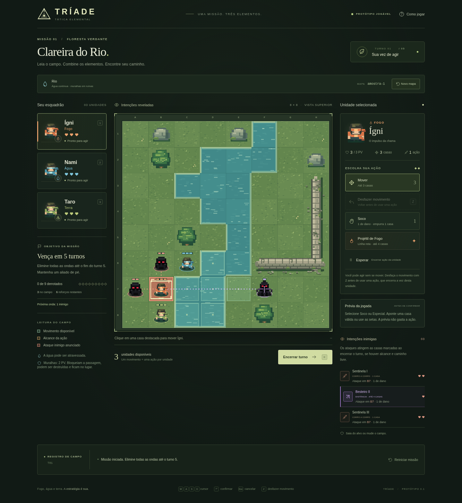

# Tríade — Clareira do Rio

Um protótipo tático 2D por turnos, com uma missão completa, arte original em pixels e interface em português. Monte uma equipe de três entre Ígni (Fogo), Nami (Água), Taro (Terra), Rai (Raio) e Sora (Vento) para eliminar todas as ondas de inimigos em até **5 turnos**, num tabuleiro 8×8 visto de cima.

Ideias para evolução do jogo, combinações dos cinco elementos e editor de mapas estão registradas em [banco-de-ideias.txt](banco-de-ideias.txt), com identificadores, origem e status para futuras consultas.

O [GDD de prototipação](GDD_Into_The_Shinobi_v0.1.md) consolida as regras existentes, as missões por rank com quatro ou cinco levels, as combinações de chakra, a narrativa e as decisões em aberto. A quantidade final de mapas e o prazo de produção ainda serão definidos; as artes finais permanecem na última etapa. Combinações e campanha ainda não fazem parte das regras implementadas.

O GDD também está disponível em [Word .doc](docs/GDD_Into_The_Shinobi_v0.1.doc) e [Word .docx](docs/GDD_Into_The_Shinobi_v0.1.docx). A [proposta de roadmap](roadmap-prototipacao.md), o [banco de ideias](banco-de-ideias.txt), a [história provisória](historia-provisoria.md) e o [cronograma anterior](cronograma-de-producao.md) preservam o planejamento e suas hipóteses. O cronograma anterior de seis fases não representa o escopo atual fechado.



## Jogar agora

Abra **[jogar.html](jogar.html)** no navegador do PC. O arquivo é autocontido: funciona offline, sem servidor, instalação, conta ou assets externos.

## Posicionamento inicial

Depois de escolher o trio, selecione um ninja no painel e clique em uma **casa azul** para escolher onde ele começa. Clicar em uma casa ocupada por outro aliado troca os dois de lugar. Ajuste a formação livremente e use **Confirmar posicionamento** para iniciar o turno 1, com todos os movimentos, ações e PV disponíveis. Os inimigos só preparam seus ataques após a confirmação.

O jogo procedural delimita até nove casas próximas à formação inicial. O teste isométrico fixo oferece seis casas. Reiniciar missão e trocar equipe retornam ao posicionamento; Novo mapa gera outra área junto com o terreno.

No editor, escolha **Efeitos → Área inicial** e pinte pelo menos três casas transitáveis sem inimigos. A marcação tem camada própria: não substitui chão, objetos ou efeitos. A borracha oferece **Área inicial** para remover só essa marcação. O teste, a biblioteca, o JSON importado e o HTML jogável preservam a área. Com a área marcada, os ninjas no editor são opcionais: a fase pode conter apenas inimigos e/ou ondas. Com menos de três sugestões, o jogador escolhe o trio antes de posicionar, inclusive no teste, na importação JSON e no HTML exportado. O arquivo do autor permanece sem os ninjas criados durante o jogo. Sem marcações, a fase mantém as posições fixas colocadas pelo autor, inclusive nos arquivos antigos.

Detalhes e capturas em [docs/posicionamento-inicial.md](docs/posicionamento-inicial.md).

## Teste visual isométrico reduzido

Abra **[teste-isometrico.html](teste-isometrico.html)** para o ensaio offline. Em desenvolvimento, acesse `/isometrico.html` ou `/?visual=isometrico`.

O ensaio usa um mapa fixo 8×8 com rio, grama, pedras e árvores; Ígni, Nami e Taro; um Sentinela e nenhuma onda adicional. Os painéis e as regras de combate são os mesmos do protótipo. Seleção, movimentos, Soco, especiais, colisões, prévias e reinício continuam disponíveis. Novo mapa, troca de equipe e importação de fase ficam desativados nesse cenário controlado.

A paleta e as silhuetas foram adaptadas da especificação visual fornecida; a projeção isométrica segue o pedido explícito deste teste. A arte é raster desenhada por código, com animações simples e ordenação por profundidade. Este ensaio não produz o conjunto completo de spritesheets ou direções previsto no documento. A versão principal e o editor conservam a apresentação atual. Detalhes em [docs/teste-isometrico.md](docs/teste-isometrico.md).

## Equipe e poderes

Antes da missão procedural, a tela de seleção permite escolher **três ninjas distintos entre cinco**. Desmarque um escolhido para abrir vaga; a ordem da seleção define os atalhos 1, 2 e 3. Todos têm 3 PV, caminhada de 3 casas, Soco e um Especial. **Trocar equipe** permite outra composição e reinicia a missão no mesmo terreno. Reiniciar missão e Novo mapa mantêm a equipe escolhida. Fases do editor começam com o trio colocado pelo autor e também permitem Trocar equipe, preservando as três casas iniciais.

- **Rai · Raio — Dash Relâmpago:** escolha uma direção ortogonal destacada. Avança até a última casa livre antes do primeiro inimigo ou estrutura, causa 1 PV e tenta empurrar o alvo uma casa. Rai perde 1 PV, mesmo quando derrota o alvo; com apenas 1 PV, ele completa o impacto e cai. Colisões seguem as regras do Soco: o alvo perde mais 1 PV e o obstáculo perde 1 PV. Árvores e muralhas recebem 1 PV do impacto e ficam paradas. Aliados, água profunda e abismo bloqueiam o dash. Uma linha sem alvo válido não gasta a ação. Pode ser usado após a caminhada e encerra a vez.
- **Sora · Vento — Rajada de Vento:** mire qualquer casa do tabuleiro, sobrevoando personagens. O centro fica intacto; cada uma das quatro casas ortogonais vizinhas é empurrada uma casa para fora. Afeta aliados, inimigos, o próprio Sora quando adjacente, pedras e barreiras. Árvores e muralhas ficam paradas; uma colisão contra elas causa 1 PV em cada parte. Sem dano direto nem empurrão em cadeia.
- **Taro · Terra:** mantém Barreira de Terra e volta ao mesmo alcance de caminhada dos demais: 3 casas.

A prévia inclui o caminho e o custo de vida do dash, os empurrões, colisões e o próximo avanço dos inimigos deslocados. **Combinações de chakra não estão implementadas.**

## Editor de mapas

Abra **[editor-offline.html](editor-offline.html)** para criar fases sem instalação. O jogo também oferece **Editor** no cabeçalho. Durante o desenvolvimento, o editor está em `/editor.html`.

- Tabuleiro 8×8 com **29 tiles**: os 24 terrenos/objetos/efeitos sugeridos, vapor, pedra incandescente, selo elétrico, água eletrizada e Área inicial.
- Camadas independentes de chão, objetos, efeitos e área inicial. Pincel com arraste, balde de chão, borracha por camada, conta-gotas, orientação e até 100 passos de desfazer/refazer. Troncos pintam dois segmentos fixos, na horizontal ou vertical.
- Ninjas opcionais quando há Área inicial, ou três posições fixas escolhidas entre os cinco elementos; múltiplos Sentinelas e Besteiros; prazo de 1 a 20 turnos e ondas configuráveis. Sem Área inicial, os personagens começam exatamente nas casas escolhidas. Com a marcação, o jogador escolhe a formação antes do combate.
- **Testar fase** abre o jogo dentro do editor. Voltar preserva o rascunho. A validação indica personagens ausentes, casas bloqueadas e efeitos em planejamento; não garante que a fase seja vencível.
- Biblioteca local com salvar, carregar, duplicar e excluir. Ela pertence ao navegador e não é um backup: use **Baixar fase** para guardar o JSON. Também é possível copiar e colar JSON em **Importar / JSON**.
- **Baixar fase jogável (.html)** cria um arquivo independente, com jogo e mapa embutidos, que funciona offline. O jogo normal importa arquivos de fase pelo botão **Fase**.

Regras disponíveis no teste: terreno comum; lama com custo de entrada 2; água profunda e abismo bloqueando caminhada; ponte transitável; árvores, pedras e muralhas; caixas móveis de 1 PV; pilares e segmentos de tronco fixos de 2 PV; pedras incandescentes móveis de 2 PV; vapor bloqueando projéteis; entradas de reforços marcadas.

Os tiles com **◇** mostram sua regra atual e o efeito ainda planejado. Gelo não desliza; arbustos não ocultam; troncos não se movem como uma peça única; pilares não tombam; pontes não são destruídas; espinhos, brasa, correnteza, selos e água eletrizada não aplicam seus efeitos especiais. Placas, santuários e solo rachado são marcadores, sem mecanismos ou novos objetivos. O aviso acompanha o teste e o HTML exportado. Combinações elementais continuam no banco de ideias.

Uma fase de exemplo está em [public/fase-exemplo.json](public/fase-exemplo.json). O formato é documentado em [docs/formato-fases.md](docs/formato-fases.md). `npm run build` também atualiza **triade-tatica.zip**, incluindo jogo, editor offline, exemplo e banco de ideias.

## Mapas procedurais

Cada nova missão gera um mapa 8×8 com grama, árvores, pedras móveis e muralhas em ruínas. A água forma um **rio contínuo**, um **lago interior** ou uma **costa irregular**, sem células soltas. As muralhas aparecem em trechos conectados e abertos, com extremidades quebradas, rachaduras e musgo.

Muralhas têm **2 PV**, bloqueiam caminhada e disparos e não podem ser empurradas. Socos e colisões podem destruí-las; a casa fica livre imediatamente. A Onda não as move nem causa dano direto nelas. Pedras e barreiras continuam móveis.

**Reiniciar missão** restaura o mesmo mapa. **Novo mapa** pede confirmação e gera outro cenário. O código mostrado na interface e o parâmetro `?map=codigo` permitem reproduzir o terreno, inclusive no HTML offline. A geração verifica caminhos entre as posições iniciais e entradas livres para os reforços.

Exemplos reproduzíveis: [rio — amostra-1](docs/mapa-rio.png), [lago — amostra-11](docs/mapa-lago.png) e [costa — amostra-0](docs/mapa-costa.png).

A validação geométrica cobre 400 sementes. Sete mapas das três formações também têm sequências legais de vitória no turno 5; isso não constitui garantia de vitória para toda semente possível.

## Projeto do GDevelop

No **GDevelop 5**, escolha **Abrir um projeto** e selecione **[gdevelop/triade.json](gdevelop/triade.json)**. Abra a cena **Batalha** e execute o **Preview**.

O projeto tem os 14 grupos de eventos pedidos no briefing, de Inicialização a Reinício da missão. Os grupos usam **eventos JavaScript**: o motor e a interface Canvas/HTML ficam embutidos no JSON, sem extensões ou downloads. As entradas são consumidas pelo grupo correspondente. As variáveis de cena `Turno`, `LimiteTurnos`, `Fase`, `AliadosVivos`, `InimigosVivos`, `Derrotados`, `ReforcosRestantes` e `Intencoes` ficam disponíveis no depurador.

O tabuleiro e os personagens são desenhados em tempo de execução. Por isso, a cena aparece vazia no editor visual; eles não são objetos Sprite nativos para arrastar. Edite as regras em `src/engine.js`, a arte em `src/art.js` e a interface em `src/app.js` / `src/style.css`; depois rode `npm run gdevelop` para atualizar o projeto e o HTML offline. Alterações manuais no JSON gerado serão substituídas.

A execução dos 14 grupos foi testada em Chromium com uma cena simulada. **A importação, o Preview no editor oficial e a exportação para executável ainda precisam ser conferidos no GDevelop.**

## Desenvolvimento

Requer Node.js 22.12+; validado com **Node.js 24.19.0** e npm 11.

```sh
npm ci
npm run dev
```

```sh
npm test           # testes determinísticos do motor e da geração procedural
npm run build     # gera GDevelop, jogar.html e dist/ para hospedagem estática
npm run gdevelop  # atualiza somente os dois arquivos autocontidos
```

Testes de interface com Playwright:

```sh
npx playwright install chromium
npm run test:e2e
```

Também é possível usar um Chromium já instalado:

```sh
CHROMIUM_PATH=/caminho/do/chromium npm run test:e2e
```

Na máquina de nuvem, use `--cache /tmp/triade-npm-cache` com `npm ci` se o diretório de cache padrão não for gravável. Não são necessários serviços de banco de dados, variáveis de ambiente ou credenciais.

## Controles

| Controle                                        | Ação                                      |
| ----------------------------------------------- | ----------------------------------------- |
| Clique em um aliado ou em seu cartão            | Selecionar unidade                        |
| Clique em uma casa verde                        | Mover até 3 casas com qualquer ninja      |
| Desfazer movimento / Z                          | Voltar à origem antes de usar uma ação    |
| Soco / Especial + clique em uma casa de alcance | Executar ação                             |
| Esperar                                         | Concluir a vez da unidade                 |
| Encerrar turno / E                              | Resolver as intenções inimigas            |
| WASD / setas                                    | Mover cursor no tabuleiro                 |
| Enter / Espaço                                  | Confirmar casa                            |
| Esc                                             | Cancelar seleção de ação / fechar diálogo |
| 1 / 2 / 3                                       | Selecionar o 1º / 2º / 3º ninja da equipe |

Usar uma ação sem se mover também é permitido e conclui a vez da unidade. Para usar **Onda Circular**, escolha o Especial e confirme **na própria casa de Nami**, realçada em azul. O cursor é posicionado nessa casa, permitindo confirmar com Enter ou Espaço. As quatro vizinhas laranja mostram a área afetada; clicar nelas não dispara a habilidade.

Depois de mover um aliado, use **Desfazer movimento** ou **Z** para voltar à origem e escolher outro destino. Selecionar Soco/Especial, consultar uma prévia ou tentar um ataque inválido mantém essa opção. Atacar, usar um Especial, Esperar ou encerrar o turno confirma a jogada e impede o retorno. O histórico pertence a cada aliado: trocar de seleção não o apaga.

Desfazer altera apenas a posição e devolve o movimento da unidade; vida, estruturas, inimigos e ações de outros aliados são preservados. A origem e a rota original precisam continuar livres. Um empurrão externo invalida o retorno daquele movimento voluntário. Reiniciar descarta todos os históricos.

## Objetivo e ondas

Elimine **9 inimigos** até o fim do turno 5, mantendo pelo menos um aliado vivo. A missão começa com dois Sentinelas e um Besteiro. Nos turnos 2, 3, 4 e 5 chegam, respectivamente, **1, 2, 1 e 2 reforços**, misturando os dois tipos de inimigo. A sequência é fixa para permitir planejar as jogadas e reproduzir as prévias.

Os reforços entram pelas bordas livres antes do planejamento inimigo e anunciam seus ataques antes de você agir. Só atacam ao encerrar a vez seguinte do jogador. Se as entradas estiverem bloqueadas, aguardam uma casa livre; continuam contando entre os inimigos a eliminar. O painel informa quantos estão no campo, quantos ainda chegam e o tamanho da próxima onda.

Limpar o campo antes da última onda mantém a missão em andamento. Eliminar o último inimigo da última onda vence imediatamente. Encerrar o turno 5 com inimigos ou reforços pendentes causa **Tempo esgotado**; não existe turno 6. Perder os três aliados também derrota. Reiniciar restaura o prazo, as ondas e o progresso.

## Prévia das ações

Selecione **Soco** ou um **Especial** e aponte uma casa válida com o mouse, ou use as setas no tabuleiro. Antes de confirmar, o painel mostra a vida antes e depois, unidades derrotadas, empurrões, colisões e alterações nas estruturas. Pedras e barreiras têm fantasma e seta indicando o destino, sem aparecer como destruídas e recriadas. A Onda inclui os aliados e estruturas afetados. Consultar a prévia não gasta ações nem altera a partida ou o histórico de movimento.

No tabuleiro, a seta contínua e o personagem transparente indicam **1 · Empurrão imediato**. A seta roxa tracejada indica **2 · Próximo avanço** do inimigo deslocado. Esse caminho considera que você **encerra o turno agora**, sem outras jogadas; inclui os ataques anunciados, os reforços e o prazo da missão. Se o inimigo permanecer parado, for derrotado ou a batalha terminar, o painel informa isso. Outras ações recalculam a previsão. A prévia também mostra a nova direção e as casas ameaçadas pelo inimigo empurrado. O ataque acompanha o deslocamento sem girar nem voltar a mirar nos aliados.

Aponte outra casa para comparar, saia do tabuleiro ou pressione Esc para limpar a prévia. Clique ou use Enter/Espaço para executar a ação. As descrições acessíveis das casas também incluem os resultados previstos.

## Regras implementadas

- **Mapa:** 64 células de 64×64 pixels lógicos; grama, água em rio/lago/costa, pedras, árvores e muralhas em ruínas. Pedras e árvores ficam inteiramente dentro da própria célula. Água não tem penalidade de movimento.
- **Esquadrão:** 3 PV, movimento ortogonal de até **3 casas para todos os cinco ninjas**, um deslocamento e uma ação por turno. Unidades não atravessam outras unidades ou obstáculos.
- **Soco:** alcance de 1 casa ortogonal, causa 1 de dano e empurra o inimigo (mesmo derrotado pelo golpe), pedra ou barreira sobrevivente **uma casa na direção do golpe**, com animação curta. Água permite o empurrão normalmente. A borda impede o deslocamento sem dano adicional. Contra árvore, pedra, muralha, barreira ou **outro personagem**, o alvo permanece na casa de origem e a colisão causa **mais 1 de dano no alvo e 1 no obstáculo atingido**, incluindo aliados. Assim, contra outro personagem, o alvo do Soco perde **2 PV (1 do golpe + 1 da colisão)** e o personagem atrás perde **apenas 1 PV da colisão**; a prévia discrimina essas duas fontes de dano. O empurrão de personagens é resolvido mesmo quando o golpe zera os PV: em casa livre, o personagem é arremessado antes de desaparecer; contra personagem ou estrutura, causa 1 de dano no obstáculo. A derrota é contabilizada uma única vez. Pedras e barreiras destruídas pelo dano inicial se desfazem sem empurrão. Soco em muralha causa 1 de dano sem deslocamento. Não permite atacar diretamente aliados ou árvores.
- **Projétil de Fogo:** até 4 casas em linha reta; 1 de dano ao primeiro inimigo. Unidades e obstáculos bloqueiam o projétil. É possível disparar em uma direção vazia, gastando a ação.
- **Onda Circular:** empurra simultaneamente as unidades, pedras e barreiras adjacentes uma casa, incluindo aliados, sem dano inicial. Colidir com árvore, pedra, muralha, barreira ou **outro personagem** causa **1 de dano em cada parte**. Os sobreviventes permanecem nas suas casas, mesmo quando o obstáculo é destruído ou derrotado. Bordas impedem o empurrão sem dano. Árvores e muralhas ficam paradas e não recebem dano direto da Onda. Não há empurrão em cadeia; empurrar um personagem contra uma pedra causa colisão, sem mover a pedra adiante. Os destinos de todos os alvos são avaliados antes dos efeitos.
- **Estruturas:** árvores, pedras, muralhas e barreiras têm **2 PV**. Pedras e barreiras podem ser empurradas por ataques; sua identidade e vida são mantidas ao mudar de casa. Mover uma pedra libera a origem e bloqueia o destino para movimento e tiros. O chão original é preservado, incluindo água: sair de uma casa do rio ou destruir a pedra nela restaura a água. Árvores e muralhas permanecem fixas. Colisões causam 1 de dano em cada envolvido, incluindo árvores. Árvores com 1 PV exibem copa quebrada, folhas amareladas e a indicação **1/2 PV**. Estruturas danificadas exibem vida e marcas de impacto; desaparecem ao chegar a zero PV. Reiniciar restaura o mapa inteiro.
- **Barreira de Terra:** criada em grama adjacente vazia, 2 PV, bloqueia movimento e projéteis e pode ser empurrada como uma pedra. Criar outra substitui a anterior, mesmo depois de movida.
- **Sentinelas:** corpo a corpo, 2 PV, movimento de até 2 casas e ataque adjacente de 1 de dano. Silhueta preta com rosto coberto e olhos vermelhos. Aproximam-se pelo caminho livre mais curto antes de anunciar a próxima intenção, com animação por casa ortogonal.
- **Besteiros:** ataque à distância, 1 PV, movimento de até 2 casas e disparo ortogonal de até 4 casas, causando 1 de dano. Capuz pontudo, capa, besta larga e detalhes roxos distinguem o desenho do Sentinela. Mantêm posição quando já têm linha de tiro; caso contrário, procuram uma posição de disparo. A flecha para no primeiro personagem ou barreira, incluindo inimigos. Árvores, pedras e muralhas bloqueiam sem sofrer dano do disparo.
- **Intenções:** todos os inimigos preparam um ataque a cada turno, depois de avançar até duas casas quando necessário. Quem já está em posição mantém a casa e arma o ataque. Setas persistentes mostram a direção, o caminho ameaçado é destacado no tabuleiro, e o aviso **ARMADO** aparece ao terminar o avanço. O painel mostra o deslocamento e a direção de cada inimigo. Empurrões trasladam a área de ataque junto com o personagem, preservando direção e alcance preparado; não cancelam automaticamente o ataque nem fazem o inimigo mirar de novo. Ao encerrar o turno, o sobrevivente ataca as novas casas marcadas. Personagens derrotados não atacam; estruturas e personagens ainda bloqueiam ou interceptam disparos. Raios são limitados pela borda, sem acesso a casas fora do tabuleiro. O Besteiro também prepara um disparo direcional quando não consegue alinhar um aliado naquele turno.
- **Resultado:** eliminar todas as ondas até o turno 5 vence; perder o esquadrão ou esgotar o prazo derrota. Reiniciar restaura o estado inteiro, sem recarregar a página.

Sem mana, recargas, progressão, equipamento, história ou multiplayer.

## Feedback visual

- Receber dano causa um clarão breve no sprite, um pequeno tremor e um número flutuante com a vida perdida. O efeito também aparece no golpe que derrota a unidade, antes da tela de resultado.
- Colidir com uma estrutura sólida ou personagem produz um tranco na direção do obstáculo e partículas de impacto. Ambas as partes recebem o feedback de dano, incluindo aliados.
- Os inimigos caminham pelos segmentos do caminho, em vez de saltar para o destino. O avanço ocorre depois dos ataques, e os controles permanecem bloqueados até terminar. As intenções aparecem após o posicionamento.
- Pedras e barreiras deslizam uma casa quando empurradas e mostram o choque quando bloqueadas. A animação não duplica a estrutura na origem ou no destino.
- Besteiros têm linha de intenção roxa e flecha animada. A lista de intenções identifica o tipo, o alcance e os ataques bloqueados. O painel do objetivo destaca o último turno.
- A preferência de movimento reduzido do sistema elimina a caminhada animada, o tranco e o clarão; as indicações de dano continuam visíveis.
- Reiniciar limpa os efeitos e animações pendentes.

## Validação

Os testes do motor cobrem obstáculos, caminhos, orçamento de ações, cada especial, empurrões bloqueados, colisão e dano em aliados, inimigos e estruturas, destruição de árvores/pedras/barreiras, liberação de caminhos e linhas de tiro, direção preservada após empurrões, preparação a cada turno, reinício, vitória e derrota. As previsões são comparadas com ações e turnos realmente executados, incluindo morte antes do avanço, novos reforços, disparos deslocados e prazo. Pedras e barreiras são exercitadas nas quatro direções, sobre água, em colisões e com vida acumulada. Desfazer verifica orçamento, troca de aliado, rota bloqueada, ações confirmadas e preservação das demais mudanças. Consultar a prévia preserva o histórico. Sequências de comandos legais eliminam os nove inimigos no turno 5 em sete mapas gerados. As regressões de coordenadas históricas usam um cenário clássico explícito; a inicialização de produção e os arquivos distribuídos usam geração procedural. Também são verificados entrada bloqueada, chegada sem ataque imediato e fim da partida sem iniciar o turno 6.

Os testes de navegador exercitam mouse, teclado, os três especiais, ativação da Onda na própria casa, Soco com empurrão e colisão, dano de colisão em aliados e estruturas, choque entre personagens, pedras e barreiras móveis, desfazer com botão e Z, reinício, ajuda, layout móvel, vitória no turno 5, derrota por tempo, derrota do esquadrão, HTML offline e os eventos embutidos no projeto do GDevelop. Também comparam as prévias com a jogada executada e verificam cancelamento e atualização após outras ações. Os testes visuais inspecionam pixels reais do canvas para verificar desenhos dos inimigos, flecha, clarão, colisão, trajetos, rochas sobre água, deslizamento sem duplicação e limpeza dos efeitos, incluindo movimento reduzido. Nenhuma API de teste altera o estado da partida para obter vitória ou derrota.

## Estrutura

```text
src/maps.js                    Geração procedural reproduzível e posições iniciais
src/engine.js                  Regras e estado da batalha, independentes da interface
src/art.js                     Sprites, tiles e desenho do tabuleiro
src/app.js                     Interface e controles
src/preview.js                 Texto e descrições acessíveis das previsões
src/style.css                  Estilos responsivos
scripts/generate-gdevelop.mjs  Gera projeto GDevelop e HTML offline a partir da mesma fonte
gdevelop/triade.json           Projeto autocontido para GDevelop 5
jogar.html                    Versão autocontida para jogar offline
tests/                        Regras e jornadas reais de interface
```
