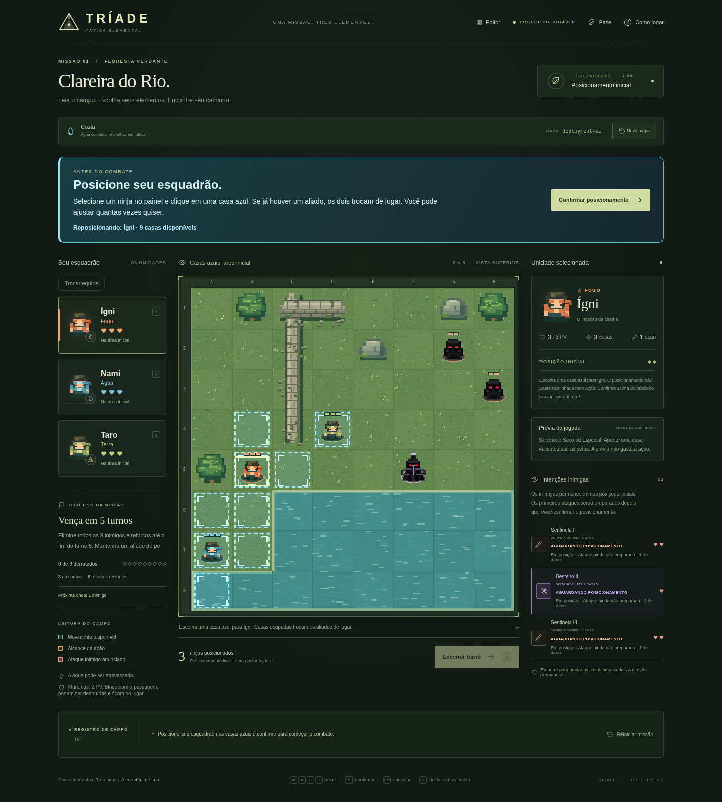
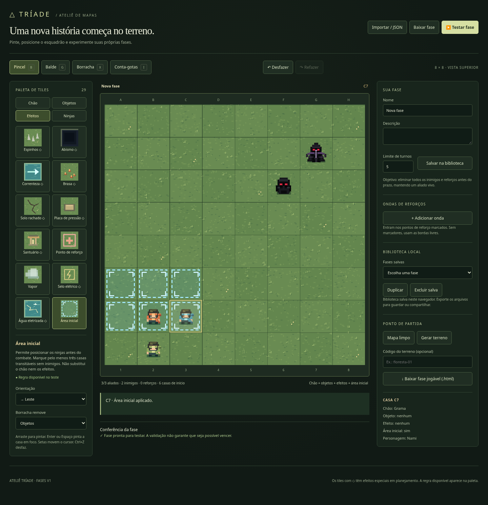
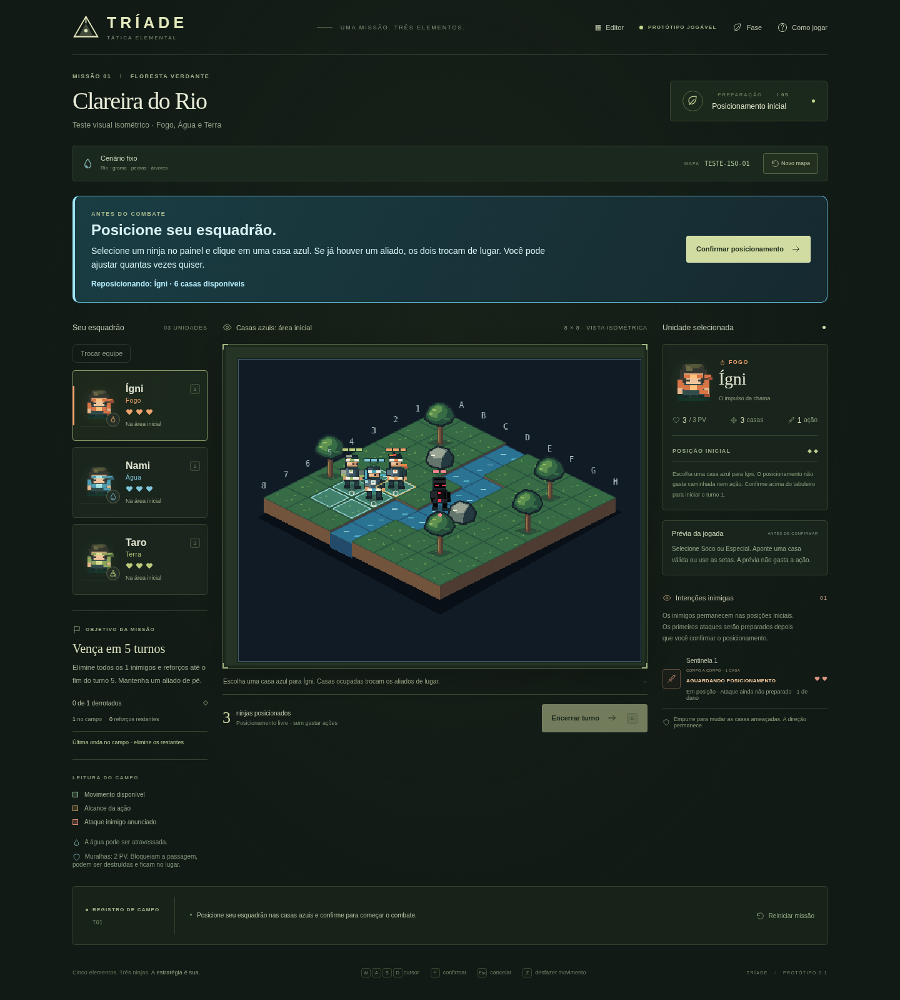

# Posicionamento inicial — 22/10/2026

Antes do combate, o jogador pode escolher a casa inicial de cada um dos três ninjas dentro da área azul. Seleciona o ninja no painel ou com 1, 2 e 3; clica numa casa marcada ou usa o cursor e Enter/Espaço. Se houver outro aliado na casa, ambos trocam de posição. Não há custo de movimento, ação, PV ou turno. **Confirmar posicionamento** inicia o turno 1 e só então prepara os inimigos.

- Protótipo procedural: até nove casas livres próximas da formação original, reproduzíveis pelo código do terreno.
- Ensaio isométrico: seis casas no mapa fixo; a mesma regra lógica com marcação em losangos.
- Reinício, novo mapa e confirmação de outra equipe oferecem novamente o posicionamento inicial.
- Enquanto a formação está sendo escolhida, ataques, caminhada de combate, desfazer e encerramento de turno ficam indisponíveis.

## Editor

Em **Efeitos → Área inicial**, pinte os locais permitidos. A marcação pertence à camada independente `deployment`: preserva o chão, objetos e efeitos. O painel informa a quantidade de casas marcadas. A borracha tem opção **Área inicial**, além de **Tudo na casa**.

São necessárias pelo menos três casas transitáveis sem inimigos. Casas marcadas sobre obstáculos ou inimigos não servem de destino e geram um aviso. Com menos de três destinos válidos, Testar fase e exportação jogável informam o problema; rascunhos e JSON ainda podem ser salvos.

Os ninjas colocados pelo autor são opcionais quando existe Área inicial. É possível salvar e testar uma fase só com terreno, área, inimigos e/ou ondas. Com zero, um ou dois ninjas sugeridos, o jogador escolhe o trio antes de posicionar; com três, a formação sugerida é mantida e pode ser alterada em Trocar equipe. Os ninjas escolhidos são criados somente no jogo e não são adicionados ao JSON do editor. Reiniciar mantém o trio escolhido e reabre o posicionamento.

Biblioteca, histórico, importação/exportação JSON e HTML independente preservam a área. Fases sem marcadores, inclusive arquivos antigos v1, continuam com início imediato e posições fixas. Consulte [o formato das fases](formato-fases.md).

## Integração

O motor usa a fase `deployment`, `deploy(x, y)` para reposicionar o ninja selecionado e `confirmDeployment()` para iniciar o combate. Arquivos de fase marcados habilitam a etapa automaticamente. Para uma batalha procedural criada diretamente pelo código, use `new Battle({ deployment: true })`; a interface principal já passa essa opção. Cenários sem marcações continuam compatíveis com o início anterior.

O projeto GDevelop consome os comandos de posicionamento no grupo de movimentação, mantendo os 14 grupos existentes. Os HTMLs e o ZIP são regenerados por `npm run build`.

## Verificação

Testes de regras cobrem isolamento do JSON, arquivos antigos, destinos inválidos, trocas, bloqueio das ações, preparação inimiga, reinício, mudança de trio, mapas procedurais e exportação. Testes de interface cobrem mouse, teclado, validação do editor, biblioteca, importação e HTML exportado sem rede.

Nesta sessão, o Chromium gerenciado bloqueia navegação `file://` com `ERR_BLOCKED_BY_ADMINISTRATOR`. Por isso, os quatro testes antigos que abrem arquivos por esse protocolo ficam fora da execução de regressão na nuvem. O novo teste de exportação lê os bytes do HTML gerado e os renderiza em uma página com a rede desativada; isso verifica o arquivo autocontido, mas não substitui a abertura por `file://` em outro PC.
